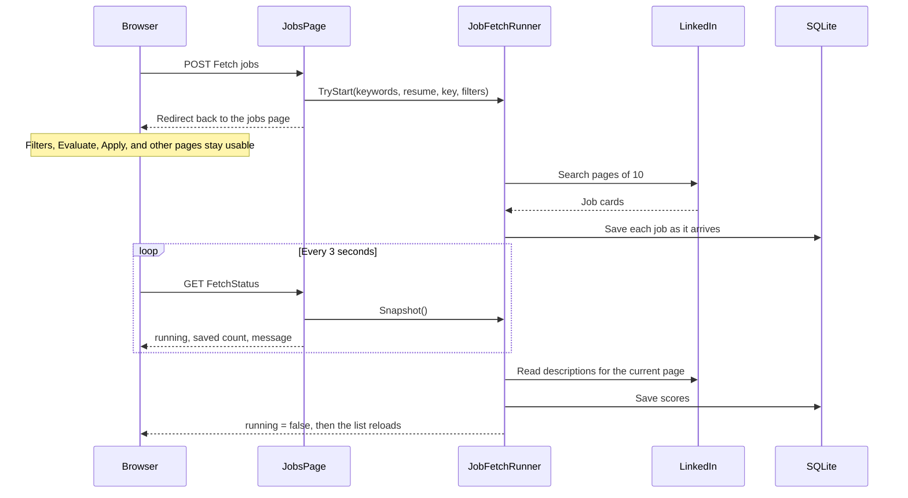

# Asynchronous Fetch jobs

The Fetch jobs button returns immediately. LinkedIn downloading and scoring continue in a shared background runner, and the jobs page polls that runner for status.

A normal `async` page handler is not enough. `OnPostFetchAsync` would still hold the browser until LinkedIn and scoring finished. The request has to return immediately, and the long work has to continue after that response.

## What you can do while a fetch runs

- Filter the list, change pages, and open another page.
- Score a row, score the current page, or click Apply.
- Watch the notice update with how many listings have been saved.

The Fetch jobs button shows **Fetching…** and is disabled until the current fetch finishes. A second click is ignored with the message "A LinkedIn fetch is already running."

Stopping the application stops the fetch. Jobs already written to `src/AutomateJob.Web/App_Data/jobs.sqlite` remain.

## Flow



One fetch runs at a time. The browser request does not wait for LinkedIn. The runner copies the form values first, then opens its own service scope, because the page object is gone after the redirect.

## Files

| Piece | File |
| --- | --- |
| Button, notice, and poll script | `src/AutomateJob.Web/Pages/Jobs.cshtml` |
| Start the fetch and return status | `src/AutomateJob.Web/Pages/Jobs.cshtml.cs` |
| Background runner | `src/AutomateJob.Web/Jobs/JobFetchRunner.cs` |
| Save each LinkedIn page as it arrives | `src/AutomateJob.Web/Jobs/LinkedInJobBoard.cs` |
| WAL so reads continue during saves | `src/AutomateJob.Web/Jobs/JobStore.cs` |
| Singleton registration | `src/AutomateJob.Web/Program.cs` |

## 1. Start the work and return

`OnPostFetchAsync` checks the resume and keywords, starts the runner, and redirects. It does not call LinkedIn itself. The OpenAI key is kept in the session only when it starts with `sk-`.

The request values are copied into a `JobFetchRequest` before the redirect: keywords, location, resume text, API key, and the current page filters. The background task cannot read the form or the session after the response has been sent.

```csharp
public async Task<IActionResult> OnPostFetchAsync(CancellationToken cancellationToken)
{
    var apiKey = ResolvePostedApiKey();
    if (!await TryReadResumeAsync(cancellationToken))
    {
        return Page();
    }

    if (string.IsNullOrWhiteSpace(ResumeText))
    {
        ErrorMessage = "Add your resume so each job can be scored.";
        LoadJobs();
        return Page();
    }

    if (string.IsNullOrWhiteSpace(Keywords))
    {
        ErrorMessage = "Add search keywords, or use Suggest search from the resume.";
        LoadJobs();
        return Page();
    }

    if (!_fetch.TryStart(new JobFetchRequest(
        Keywords.Trim(),
        Location?.Trim() ?? "",
        apiKey,
        ResumeText!,
        ShowWeakMatches,
        PostedFrom,
        PostedTo,
        string.IsNullOrWhiteSpace(Place) ? null : Place.Trim(),
        PageNumber)))
    {
        ErrorMessage = "A LinkedIn fetch is already running. You can keep using the list while it finishes.";
        LoadJobs();
        return Page();
    }

    return RedirectToPage(new
    {
        p = PageNumber,
        from = PostedFrom?.ToString("yyyy-MM-dd"),
        to = PostedTo?.ToString("yyyy-MM-dd"),
        place = Place,
        ShowWeakMatches
    });
}

public IActionResult OnGetFetchStatus()
{
    return new JsonResult(_fetch.Snapshot());
}
```

The runner is one singleton for the whole application:

```csharp
builder.Services.AddSingleton<AutomateJob.Web.Jobs.JobFetchRunner>();
```

Every jobs-page load copies the snapshot into the banner:

```csharp
var fetch = _fetch.Snapshot();
FetchRunning = fetch.Running;
FetchFailed = fetch.Failed;
FetchMessage = string.IsNullOrWhiteSpace(fetch.Message) ? null : fetch.Message;
```

## 2. Background runner

`TryStart` refuses a second fetch. `RunAsync` is not awaited, so the HTTP request can finish. The cancellation token is the application shutdown token, not the request token. A new scope supplies the LinkedIn and OpenAI clients for the life of the fetch.

`JobStore`, `EvaluationStore`, and `LlmJobMatcher` are resolved from that scope. The stores are singletons. The LinkedIn and OpenAI clients are created for this fetch and disposed when the scope ends.

```csharp
public sealed record JobFetchRequest(
    string Keywords,
    string Location,
    string? ApiKey,
    string ResumeText,
    bool ShowWeakMatches,
    DateOnly? PostedFrom,
    DateOnly? PostedTo,
    string? Place,
    int PageNumber);

public sealed record JobFetchSnapshot(bool Running, bool Failed, string Message, int Saved);

public bool TryStart(JobFetchRequest request)
{
    lock (_gate)
    {
        if (_running)
        {
            return false;
        }

        _running = true;
        _failed = false;
        _saved = 0;
        _message = "Fetching jobs from LinkedIn. You can keep using the application.";
    }

    _ = RunAsync(request);
    return true;
}
```

The run scores the current page, downloads the LinkedIn list, saves each job, then scores the current page again. When an `sk-` key or a resume is missing, scoring is skipped and the listings are still saved.

```csharp
private async Task RunAsync(JobFetchRequest request)
{
    var token = _lifetime.ApplicationStopping;
    try
    {
        await using var scope = _scopes.CreateAsyncScope();
        var board = scope.ServiceProvider.GetRequiredService<LinkedInJobBoard>();
        var store = scope.ServiceProvider.GetRequiredService<JobStore>();
        var evaluations = scope.ServiceProvider.GetRequiredService<EvaluationStore>();
        var matcher = scope.ServiceProvider.GetRequiredService<LlmJobMatcher>();

        var (scored, relevant, missed) = await ScoreVisibleAsync(request, board, store, evaluations, matcher, token);
        var found = await board.SearchAsync(request.Keywords, request.Location, token, job =>
        {
            store.SaveListing(job);
            lock (_gate)
            {
                _saved++;
                _message = $"Fetching jobs from LinkedIn. {_saved} saved so far. You can keep using the application.";
            }
        });

        var listed = await ScoreVisibleAsync(request, board, store, evaluations, matcher, token);
        scored += listed.Scored;
        relevant += listed.Relevant;
        missed += listed.Missed;

        var cap = found.Count >= 1000 ? " LinkedIn's public search stops at 1,000 jobs." : "";
        var message = string.IsNullOrWhiteSpace(request.ApiKey)
            ? $"Listed {found.Count} jobs. The Score column stays blank until you paste an OpenAI key that starts with sk- and click Score this page.{cap}"
            : missed == 0
                ? $"Listed {found.Count} jobs. The Score column now shows {scored} scores. {relevant} are relevant to the resume.{cap}"
                : $"Listed {found.Count} jobs. {missed} jobs on this page could not be scored.{cap}";
        lock (_gate)
        {
            _failed = false;
            _message = message;
        }
    }
    catch (InvalidOperationException exception)
    {
        Fail(exception.Message);
    }
    catch (HttpRequestException)
    {
        Fail("OpenAI could not be reached. Jobs already scored are still in the table.");
    }
    catch (TimeoutException)
    {
        Fail("LinkedIn took too long on one job. Jobs already scored are still in the table. Fetch again.");
    }
    catch (TaskCanceledException)
    {
        Fail("The fetch was cancelled. Jobs already scored are still in the table.");
    }
    catch (Exception)
    {
        Fail("The LinkedIn fetch stopped. Jobs already saved are still in the table.");
    }
    finally
    {
        lock (_gate)
        {
            _running = false;
        }
    }
}
```

Status is a small snapshot: `Running`, `Failed`, `Message`, and `Saved`. A lock guards those fields because the page reads them while the fetch writes them.

## 3. Save each LinkedIn page as it arrives

LinkedIn returns 10 jobs per page, up to 1,000, with a short delay between pages. `onListed` runs for each new card, so the database grows before the search ends.

```csharp
public async Task<IReadOnlyList<LinkedInJob>> SearchAsync(
    string keywords,
    string location,
    CancellationToken cancellationToken,
    Action<LinkedInJob>? onListed = null)
{
    var jobs = new List<LinkedInJob>();
    for (var start = 0; start < MaxResults; start += PageSize)
    {
        cancellationToken.ThrowIfCancellationRequested();
        if (start > 0)
        {
            await Task.Delay(TimeSpan.FromMilliseconds(500), cancellationToken);
        }

        var page = await GetAsync(ListUrl(keywords, location, start), cancellationToken);
        var parsed = ParseList(page);
        var added = 0;
        foreach (var job in parsed)
        {
            if (jobs.Any(item => item.Url == job.Url))
            {
                continue;
            }

            jobs.Add(job);
            added++;
            onListed?.Invoke(job);
        }

        if (parsed.Count < PageSize || added == 0)
        {
            break;
        }
    }

    if (jobs.Count == 0)
    {
        throw new InvalidOperationException("LinkedIn returned no jobs for that search. Change the keywords or location and try again.");
    }

    return jobs;
}
```

SQLite is in WAL mode so those writes do not block reading the list from another page:

```csharp
private static void UseWal(SqliteConnection connection)
{
    using var command = connection.CreateCommand();
    command.CommandText = "PRAGMA journal_mode=WAL;";
    command.ExecuteScalar();
}
```

The same title, company, and location are still stored once. `SaveListing` updates the posted time on the existing role instead of inserting another row.

## 4. Page progress

The button is disabled while a fetch is running.

```html
@if (Model.FetchRunning)
{
    <button type="button" disabled>Fetching…</button>
}
else
{
    <button type="submit" asp-page-handler="Fetch">Fetch jobs</button>
}
```

A timer asks `/Jobs?handler=FetchStatus` every 3 seconds and updates the notice, for example "Fetching jobs from LinkedIn. 40 saved so far." When `running` becomes false, the list reloads unless the cursor is in a text field. In that case the notice stays, and the list refreshes the next time you leave the field or reload yourself.

```html
@if (Model.FetchRunning)
{
    <script>
        (function () {
            const notice = document.getElementById("fetch-status");
            if (!notice) return;
            const timer = setInterval(async function () {
                try {
                    const response = await fetch("/Jobs?handler=FetchStatus", { headers: { "Accept": "application/json" } });
                    if (!response.ok) return;
                    const status = await response.json();
                    notice.textContent = status.message || notice.textContent;
                    notice.className = status.failed ? "banner" : "notice";
                    if (status.running) return;
                    clearInterval(timer);
                    const active = document.activeElement;
                    const typing = active && (active.tagName === "INPUT" || active.tagName === "TEXTAREA" || active.tagName === "SELECT");
                    if (!typing) location.reload();
                } catch (e) { }
            }, 3000);
        })();
    </script>
}
```

## Limits

- Only one fetch runs at a time. The status lives in memory on this process.
- Scoring still covers the current filtered page, before the search and again after it. It does not score every downloaded job.
- The fetch does not click Submit on a company application.
- The public LinkedIn search stops at 1,000 jobs.
