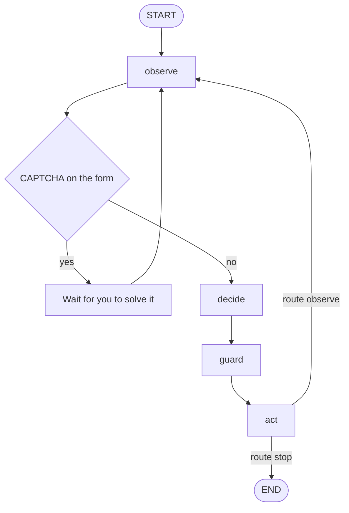
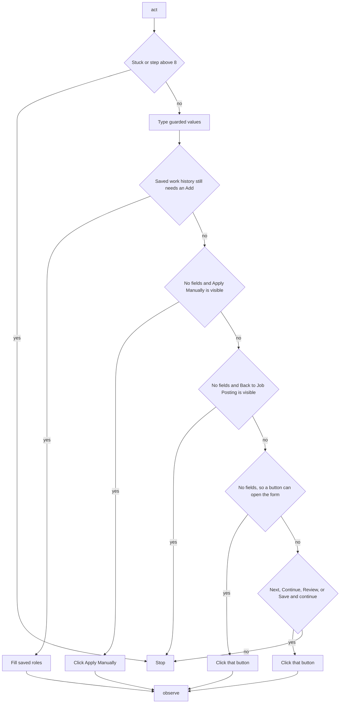

# LangGraph apply workflow

The filler is a LangGraph state machine in `agent/graph.py`. The .NET host opens the form, then starts one graph run per attempt. A run walks the open form until it stops. After the run, and before the filled check, the host clicks Submit, Apply, or an unchecked check when one of those is on the page, then waits for the application form.

## Host, then graph

Clicking **Fill with LangGraph** opens the LinkedIn job, then clicks **Apply** or **Easy Apply**. Apply leaves LinkedIn and opens the employer application form. Easy Apply stays on LinkedIn and opens LinkedIn’s own form. Up to three attempts are made. Each attempt opens the LinkedIn job again and tries Apply first, then Easy Apply.

If the page that opens has no application fields, the graph looks for a button that leads to the application form, such as Apply, Apply now, or Apply Manually, clicks it, and waits for the form. A site search box or a dark-mode control is not an application field.

Before a result is treated as filled, the host looks at the open page. If Submit, Apply, or an unchecked terms check is available and the application form is not open yet, it clicks that control and waits for the form, then runs the graph again. A finished attempt has status `Filled` and no unanswered fields. The graph then leaves the page for you and runs again while that Chrome tab stays open. An unfinished attempt starts the next try. After three unfinished attempts, the last result is kept.

```mermaid
flowchart TD
    start[Click Fill with LangGraph] --> linkedin[Open the LinkedIn job]
    linkedin --> choice{Apply or Easy Apply}
    choice -->|Apply| employer[Employer application form]
    choice -->|Easy Apply| easyForm[LinkedIn Easy Apply form]
    employer --> hasFields{Application fields on the page}
    easyForm --> graph[Run LangGraph and fill the form]
    hasFields -->|yes| graph
    hasFields -->|no| redirect[Click a button that opens the application form]
    redirect --> graph
    graph --> gate{Submit, Apply, or other checks on the page}
    gate -->|yes| clickOpen[Click and wait for the application form]
    clickOpen --> graph
    gate -->|no| done{Status Filled and nothing left blank}
    done -->|yes| stop[Leave Submit for you]
    stop --> tab{Chrome tab still open}
    tab -->|yes| graph
    tab -->|closed| closed[Stop]
    done -->|no, tries left| linkedin
    done -->|no, third try| keep[Keep the last result]
```

Easy Apply stays on the LinkedIn page. The graph reads and fills only the Easy Apply dialog. Apply opens the employer tab and the graph fills that page.

## Graph loop

Each run starts at `observe` and repeats until `act` routes to `stop`. The step counter starts at 0 and increases by one on every observe. When the form shows a CAPTCHA, `observe` pauses for you. It does not solve the check. After you solve it in Chrome and continue, `observe` reads the page again and the fill goes on. If the CAPTCHA is still there when you continue, the run stops and needs you. The graph also stops when the step count is above 8 or the page signature is unchanged after step 1.



| Node | What it does |
| --- | --- |
| observe | Reads fields, buttons, and the page signature from Chrome. If a CAPTCHA is on the form, pauses until you solve it and continue. Marks the run stuck when the same page is seen again, or when the CAPTCHA is still there after you continue. |
| decide | If the page is stuck, past step 8, or has no fields, it proposes nothing. Otherwise it asks the model only about blanks that saved facts cannot fill. The proposals are not used as the fill list. |
| guard | Builds the real fill list from the resume, profile, and answers bank. Passwords stay empty. Values that are not in those sources stay blank. |
| act | Types the guarded values, then chooses the next page action. |

## What act does

`act` checks these in order. The first match wins.



Inside one graph run, a button whose label contains "submit" makes `choose_action` return stop. Next, Continue, Review, and Save and continue move to the next page and the loop observes again. Submit, Apply, and unchecked checks are clicked by the host after the run, before the filled check.

## What guard will type

| Label | Value |
| --- | --- |
| Password, confirm password, phone extension | Left blank |
| Email, including retype or confirm email | Saved email |
| First, last, and full name | Saved name |
| Phone number | National digits, with a leading 91 removed when the country code is separate |
| Phone device type | Mobile, when a phone is saved |
| Country phone code | Saved country, unless the control already has a value |
| City, country, LinkedIn, website, title, years, authorization, notice, salary, relocate | Matching saved profile value |
| How did you hear about us | LinkedIn |
| Have you previously worked for this company | Yes or No from the resume and work history |
| Already filled control | Left as it is |
| Anything else | Only an answers-bank reply, or a value that already appears in the resume or profile |

Address, postal code, education, and languages stay blank when they are not saved. Those blanks make the status `Needs you`.

## How a run ends

| Result | Meaning |
| --- | --- |
| Filled | Every mapped field has a saved value, or was already filled, and the page has no Submit, Apply, or unchecked check left to open the form. |
| Needs you | A required field has no saved answer, or a CAPTCHA is still on the form after you continue. Solve the check or answer the field, then click Fill with LangGraph again. |
| Stopped early | The page did not change, the apply shell had no fields, or the step count passed 8. The host can start another attempt. |
