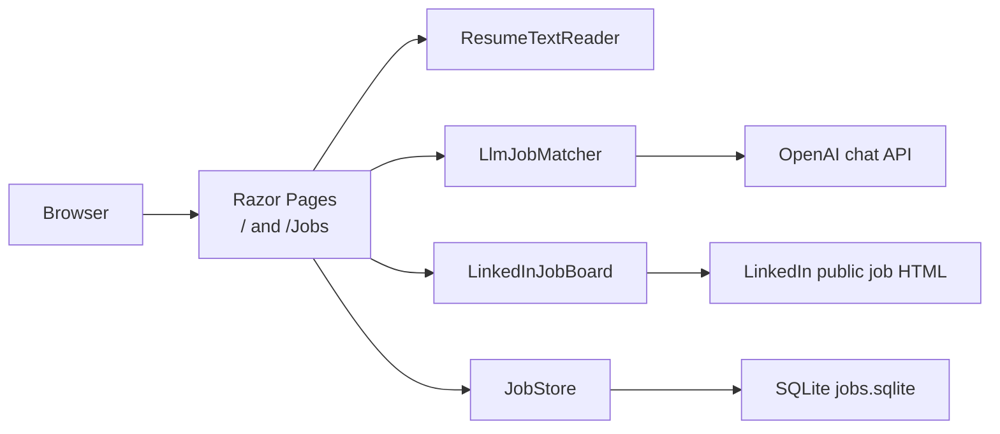
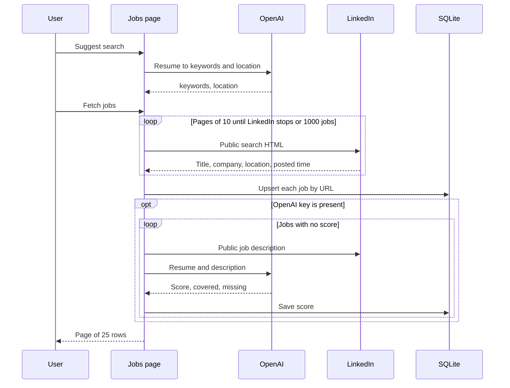

# Job Match system design

Job Match is a local ASP.NET Core app. It compares a resume with a job description and scores the fit with OpenAI. It can also read public LinkedIn job results, store them in SQLite, and score the ones that do not already have a score.

The app does not submit applications, store a LinkedIn password, or bypass LinkedIn checks.

## Runtime

| Item | Value |
| --- | --- |
| Framework | .NET 9, Razor Pages |
| Web project | `src/AutomateJob.Web` |
| Tests | `tests/AutomateJob.Tests` (xUnit) |
| Local URL | `http://localhost:5127` (`http` launch profile) |
| Model | `gpt-4.1` at `https://api.openai.com/v1/chat/completions` |
| Database | `src/AutomateJob.Web/App_Data/jobs.sqlite` |

Start the site with:

```powershell
dotnet run --project src/AutomateJob.Web/AutomateJob.Web.csproj --launch-profile http
```

## Architecture



The browser talks only to the local site. The site calls OpenAI and LinkedIn. The API key lives in the ASP.NET session for up to 8 hours. It is not written to the database or to `appsettings.json`.

## Pages

| Route | Role |
| --- | --- |
| `/` | Score one pasted job description against the resume. |
| `/Jobs` | Suggest a search, fetch LinkedIn jobs, filter, page, and score the saved list. |
| `/Privacy`, `/Error` | Template pages. |

`Update list` on `/Jobs` reloads the table from SQLite. It does not call LinkedIn.

## One job

1. The user uploads a PDF, DOCX, or TXT resume, or pastes the text. Files must be 5 MB or smaller. PDF text comes from PdfPig. DOCX text comes from `word/document.xml`.
2. The user pastes a job description of at least 40 characters and an optional title.
3. The user pastes an OpenAI key that starts with `sk-`, or the session, `Llm:ApiKey`, or `OPENAI_API_KEY` already has one.
4. `LlmJobMatcher` sends the resume and description to OpenAI and asks for a JSON score.
5. The page shows the score, verdict, summary, covered skills, missing skills, and preferred skills. Nothing from this page is stored.

Score bands:

| Score | Verdict |
| --- | --- |
| 80–100 | Strong match |
| 55–79 | Partial match |
| 0–54 | Weak match |

Each model call uses temperature `0.2`, `max_completion_tokens` 1200, and `response_format` `json_object`. Resume and description text are cut at 30,000 characters. Keys that start with `crsr_` or `xai-`, or that do not start with `sk-`, are rejected before the HTTP call. A `Bearer ` prefix and surrounding quotes are stripped.

## LinkedIn list



Search uses LinkedIn’s public guest results:

`https://www.linkedin.com/jobs-guest/jobs/api/seeMoreJobPostings/search`

Each page returns about 10 cards. The app waits 500 ms between pages and stops when a page is short, when no new jobs appear, or at 1,000 jobs. That 1,000 cap is LinkedIn’s public search limit.

Descriptions, used only while scoring, come from:

`https://www.linkedin.com/jobs-guest/jobs/api/jobPosting/{id}`

A description shorter than 80 characters is stored as an error and is not scored. Description requests wait 1.2 seconds apart. HTTP 429 responses are retried up to four times. One failed description does not drop the jobs already saved.

`LinkedInSession` can open a headed Playwright browser, but the Jobs page does not use it. Listing and descriptions go through `LinkedInJobBoard`.

## List display

`JobListQuery` filters the saved rows, then pages them.

- Page size is 25. The query parameter is `p` because Razor Pages reserves `page`.
- **Posted from** and **Posted to** keep jobs whose posted date falls in that range, inclusive. Jobs with no posted date are omitted while a date filter is set. If from is after to, the dates are swapped.
- A job is hidden when its score is below 55, it has no error, and **Show weak matches below 55** is unchecked. Unscored jobs and rows with an error stay visible.
- Sort order is score descending, posted date descending, then fetch time descending.

Fetching again updates title, company, location, and posted time for a URL that is already stored. An existing score is kept. Jobs that have left LinkedIn remain in SQLite.

## Data

`Jobs` in `jobs.sqlite`:

| Column | Meaning |
| --- | --- |
| `JobUrl` | Unique LinkedIn job URL, `https://www.linkedin.com/jobs/view/{id}/` |
| `Title`, `Company`, `Location` | Card fields |
| `Posted` | Display text, such as `2 hours ago · 10 Oct 2026` |
| `PostedOn` | Sortable date, `yyyy-MM-dd` |
| `Score` | 0–100, null until scored |
| `Summary` | Model reason |
| `Covered`, `Missing` | JSON string arrays |
| `Error` | Why scoring did not finish |
| `FetchedAt` | UTC timestamp of the last full save |

`SaveListing` inserts a new URL or updates the card fields. It does not clear a score. `Save` writes the score, summary, skill lists, and error.

Covered and missing skills on the list are the required-skill lists from the model. The one-job page also shows preferred skills. Those preferred lists are not stored.

## Configuration and secrets

Key lookup order:

1. Value pasted on the form, then kept in session `OpenAiApiKey`
2. `Llm:ApiKey` in configuration or user secrets
3. Environment variable `OPENAI_API_KEY`

`appsettings.json` sets `Llm:BaseUrl` and `Llm:Model`. Its `ApiKey` is empty. The session cookie is HttpOnly and essential, and it expires after 8 hours of idle time.

## External limits

| Call | Timeout |
| --- | --- |
| OpenAI `HttpClient` | 2 minutes |
| LinkedIn `HttpClient` | 40 seconds per request |

Scoring walks every unscored job in the current search before the page returns. A full list of 1,000 jobs is a long request because each job needs a description read and a model call.

LinkedIn can answer 429 when requests are too close together. The app backs off and continues. A later **Fetch jobs** retries rows whose score is null or whose error is set.

## Project layout

```text
src/AutomateJob.Web/
  Program.cs                 composition root
  Pages/Index.cshtml         one resume, one job
  Pages/Jobs.cshtml          LinkedIn list
  Matching/                  OpenAI client, resume reader, score model
  Jobs/                      LinkedIn reader, SQLite, list filter
  App_Data/jobs.sqlite       created on first run
tests/AutomateJob.Tests/     key checks, score JSON, list parsing, paging, date filter
```

## Tests

`dotnet test tests/AutomateJob.Tests/AutomateJob.Tests.csproj` covers:

- OpenAI URL, key prefix checks, and the incorrect-key message
- Search-suggestion JSON
- The 55-point visibility rule
- Public job-card parsing, including posted time
- List paging and posted-date filtering
